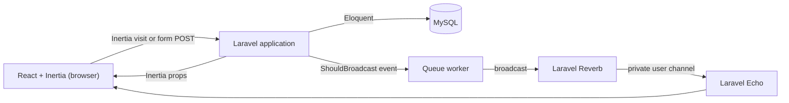

# Chatchit

A one-to-one real-time messaging application built with Laravel, Inertia.js, React, and Laravel Reverb.

## Project Overview

Chatchit lets people find each other by username, connect through a friend request, and then exchange private messages. Messages and message deletions appear in an open conversation without a page refresh. The project was built as a learning exercise around authentication, authorization, relational data, validation, rate limiting, and WebSocket broadcasting on the Laravel stack.

## Screenshots

No screenshots are committed to the repository yet. The table below lists the screens worth capturing and where to put them. Once the files exist, replace this table with image embeds.

| Screen           | Suggested file                            | What to capture                                                  |
| ---------------- | ----------------------------------------- | ---------------------------------------------------------------- |
| Desktop chat     | `docs/images/chat` | Conversation sidebar  mode            |
| Desktop chat     | `docs/images/conversation` | Conversation |
| Mobile chat list | `docs/images/mobile.png`   | Active friends strip, All/Unread filters, and the bottom tab bar |
| Friends page     | `docs/images/friends.png`            | Incoming requests, sent requests, and the friends list           |
| Profile settings | `docs/images/settings.png`   | Profile fields and the avatar upload form                        |
| Profile settings | `docs/images/settings(1).png`   | Profile fields and the avatar upload form                        |
| Dark mode        | `docs/images/chat.png`  | Any chat screen |

## Features

### Accounts and profiles

- Register with a name, unique username, email address, and password.
- Log in, log out, reset a forgotten password, and confirm a password before opening security settings.
- Sign in with a passkey (WebAuthn) and manage passkeys from the Security settings page.
- Edit name, username, bio, and email from the profile settings page.
- Upload an avatar with a local preview before saving. JPG, PNG, and WebP files up to 2 MB are accepted, the previous file is deleted, and uploads are limited to three per hour.
- Switch between light, dark, and system appearance.
- Use a responsive layout: a two-pane sidebar layout on desktop and a single-column layout with a bottom tab bar on mobile.

### Finding people and managing friends

- Search for people by username prefix. Search starts at two characters, waits 300 ms after the last keystroke, excludes the current user, and returns at most ten results.
- See relationship-aware actions in search results: **Add**, **Request sent**, **Accept**, or **Friends**.
- Send a friend request. Sending the same request twice is idempotent, and a reverse pending request is accepted automatically.
- Accept or decline an incoming request as the addressee, cancel an outgoing request as the requester, and remove an accepted friend as either participant.
- See pending friend-request counts in the chat sidebar and the mobile tab bar.
- Keep an existing conversation readable after removing a friend. New messages are blocked until a new request is accepted.

### Conversations and messages

- See every conversation in one list: partners with message history first (newest first), followed by accepted friends with no messages (alphabetical).
- See the last message preview, relative time, unread count, sent/read tick, and active-status dot in the mobile conversation list.
- Search conversations in the sidebar, and filter by **All** or **Unread** on mobile.
- Open a thread if the two people are friends or have exchanged at least one message. Opening a thread with yourself returns 404; opening one with a stranger returns 403.
- Read the latest 50 messages, oldest first, with day separators, local timestamps, and automatic scrolling to the newest message.
- Write messages in a two-row composer. Messages are limited to 1,000 characters and cannot be empty or whitespace only.
- Mark incoming messages as read when a thread is opened. The mobile conversation list shows a single tick for sent messages and a double tick for read messages.
- Hide a message from either side of the conversation. The recipient sees "This message was deleted"; the sender keeps the original text. A second delete is a no-op, and a stranger receives 403.

### Real-time updates

- A new message is appended to the open thread without a refresh.
- A message from someone other than the open conversation partner shows an informational toast instead of being added to the thread.
- A deletion is reflected in the open thread without a refresh.
- Events are broadcast on a private `user.{id}` channel that is authorized only for the matching authenticated user.

### Not included

Real-time friend changes, live unread badges outside an open thread, typing indicators, group chats, attachments, message editing, and message pagination are not implemented. See [Future Improvements](#future-improvements).

## Technology Stack

### Backend

| Package / tool     | Version | Used for                                                             |
| ------------------ | ------- | -------------------------------------------------------------------- |
| PHP                | 8.3+    | Application runtime (CI uses PHP 8.5)                                |
| Laravel            | 13      | Routing, validation, Eloquent, queues, events, broadcasting          |
| Laravel Fortify    | 1.37    | Registration, login, password reset, password confirmation, passkeys |
| Inertia Laravel    | 3       | Server-side page rendering and props                                 |
| Laravel Reverb     | 1       | WebSocket server                                                     |
| Laravel Wayfinder  | 0.1     | Typed TypeScript route and controller helpers                        |
| Pest               | 5       | Test runner                                                          |
| Pint               | 1.27    | PHP code style                                                       |
| Larastan / PHPStan | 3.9     | Static analysis                                                      |

### Frontend

| Package / tool        | Version | Used for                                               |
| --------------------- | ------- | ------------------------------------------------------ |
| React                 | 19      | UI components and page rendering                       |
| TypeScript            | 5.7     | Typed props, data shapes, and generated route helpers  |
| Inertia React         | 3       | Page components, forms, links, and partial reloads     |
| Tailwind CSS          | 4       | Styling and responsive layout                          |
| shadcn/ui + Radix UI  | -       | Accessible dialogs, dropdowns, tabs, inputs, and menus |
| Lucide React          | 0.475   | Icons                                                  |
| Sonner                | 2       | Toast notifications                                    |
| Laravel Echo          | 2.6     | WebSocket client                                       |
| `@laravel/echo-react` | 2.6     | `useEcho` hook and Echo configuration                  |
| Vite (vite-plus)      | 1.4     | Asset bundling and development server                  |

### Additional tools

- MySQL for local development, with SQLite in-memory databases for tests.
- Composer 2 and npm (Node 22 in CI).
- GitHub Actions for continuous integration.
- Laravel Herd is optional; the example environment uses `http://chat-app.test`.
- Laravel Boost, Laravel Pail, and Laravel Tinker are available as development helpers.

## Architecture

Chatchit is a server-driven Inertia application. Laravel owns routing, authentication, authorization, validation, and persistence. Instead of returning HTML templates or a separate JSON API, controllers return Inertia page components with props. React renders those pages in the browser. Wayfinder generates typed TypeScript functions for named routes and controller actions so the frontend does not hard-code URLs.

Real-time updates use a second channel alongside normal HTTP requests. Laravel dispatches broadcast events, a queue worker hands them to Reverb, and Laravel Echo delivers them to the browser over a private WebSocket channel.



### Message delivery flow

1. The composer submits a POST request to `/chat/{user}/messages` through Inertia's `useForm`.
2. `StoreMessageRequest` validates the body: required, at most 1,000 characters, and not whitespace only.
3. `MessageController` rejects self-messages with 404 and non-friends with 403, then saves the message.
4. `MessageSent` implements `ShouldBroadcast` and broadcasts as `message.sent` on the recipient's private `user.{id}` channel.
5. Because the event is queued, a queue worker sends it to Reverb. With `QUEUE_CONNECTION=sync` the broadcast happens immediately in the request.
6. Echo listens on the authenticated user's channel in `resources/js/pages/chat/show.tsx`. A message from the open partner is appended to the thread; a message from anyone else produces a toast.
7. The sender receives an Inertia response that refreshes the thread, while the recipient's open thread updates from the WebSocket event.

Deleting a message follows the same pattern. `MessageDeleted` broadcasts only the message ID to both participants, and the open thread replaces the body with the deleted-message placeholder for the recipient.

Broadcast dispatch is wrapped in a try/catch and reported, so a broadcasting problem does not undo the saved message or deletion.

### Key directories

| Path                      | Responsibility                                                      |
| ------------------------- | ------------------------------------------------------------------- |
| `app/Http/Controllers`    | Page controllers and message/friend actions                         |
| `app/Http/Requests`       | Form Request validation                                             |
| `app/Models`              | Eloquent models and relationships                                   |
| `app/Services`            | Friend-request state transitions and transaction locking            |
| `app/Policies`            | Message deletion authorization                                      |
| `app/Events`              | Broadcast events                                                    |
| `app/Http/Middleware`     | Shared Inertia props and last-seen tracking                         |
| `routes/web.php`          | Authenticated application routes                                    |
| `routes/channels.php`     | Private channel authorization                                       |
| `resources/js/pages`      | Inertia page components                                             |
| `resources/js/components` | Chat, friends, settings, and UI components                          |
| `resources/js/actions`    | Wayfinder-generated controller helpers                              |
| `resources/js/routes`     | Wayfinder-generated named-route helpers                             |
| `database/migrations`     | Users, messages, friendships, queues, sessions, and passkeys schema |
| `tests/Feature`           | Pest feature tests                                                  |

## Installation and Setup

### Prerequisites

- PHP 8.3 or newer with the usual Laravel extensions
- Composer 2
- Node.js 22 or newer and npm
- MySQL (the example environment uses a database named `chat_app`)
- Optional: Laravel Herd for serving the site at `http://chat-app.test`

### 1. Clone the repository

```bash
git clone https://github.com/Dreikopia/chat-app.git
cd chat-app
```

### 2. Install dependencies

```bash
composer install
npm install
```

### 3. Create the environment file and application key

macOS or Linux:

```bash
cp .env.example .env
php artisan key:generate
```

Windows PowerShell:

```powershell
Copy-Item .env.example .env
php artisan key:generate
```

### 4. Create and configure the database

Create a MySQL database named `chat_app`, then update these values in `.env` if your credentials differ:

```dotenv
DB_CONNECTION=mysql
DB_HOST=127.0.0.1
DB_PORT=3306
DB_DATABASE=chat_app
DB_USERNAME=root
DB_PASSWORD=
```

To use SQLite instead, comment out the MySQL values, uncomment the SQLite lines in `.env.example`, and create the database file:

```bash
touch database/database.sqlite
```

### 5. Run migrations

```bash
php artisan migrate
```

To load the optional demo conversations and friend requests:

```bash
php artisan migrate --seed
```

The demo seeder creates `john@test` plus several conversation partners and a pending request from `ana@test`. The demo accounts share a fixed development-only password defined in `database/seeders/ChatDemoSeeder.php`; do not reuse it outside local development.

### 6. Create the storage link

Avatars are stored on the public disk, so the public storage link is required:

```bash
php artisan storage:link
```

### 7. Set the Reverb credentials

`.env.example` includes the Reverb variables but leaves the credentials empty. Set a local app ID, key, and secret before starting the app:

```dotenv
REVERB_APP_ID=123456
REVERB_APP_KEY=local-key
REVERB_APP_SECRET=local-secret
```

The `VITE_REVERB_*` variables already reference these values, so they normally do not need editing. Use unique credentials outside local development.

### 8. Start the development servers

```bash
composer run dev
```

This runs four processes through `php artisan dev`:

- the Laravel development server
- the queue listener
- the Reverb WebSocket server
- the Vite development server

Open the URL configured in `APP_URL`. The example environment points to `http://chat-app.test`, which matches Laravel Herd. If you use `php artisan serve` instead, set `APP_URL=http://127.0.0.1:8000` so passkey configuration and generated URLs match the server address.

To run the processes separately:

```bash
php artisan serve
php artisan reverb:start --debug
php artisan queue:work
npm run dev
```

The queue worker is required when `QUEUE_CONNECTION=database`, because both broadcast events are queued. If you set `QUEUE_CONNECTION=sync`, broadcasts run inside the request and the worker is not needed.

### 9. Build assets for production

```bash
npm run build
```

If a frontend change does not appear in the browser, confirm that Vite is running in development or rebuild the assets.

## Environment Configuration

The values below are the ones that matter most in `.env.example`.

| Variable               | Purpose                                                                 | Example value          |
| ---------------------- | ----------------------------------------------------------------------- | ---------------------- |
| `APP_NAME`             | Application name shown in page titles                                   | `Chat App`             |
| `APP_URL`              | Base URL used for links and passkey configuration                       | `http://chat-app.test` |
| `DB_CONNECTION`        | Database driver                                                         | `mysql`                |
| `DB_HOST`              | Database host                                                           | `127.0.0.1`            |
| `DB_PORT`              | Database port                                                           | `3306`                 |
| `DB_DATABASE`          | Database name                                                           | `chat_app`             |
| `DB_USERNAME`          | Database user                                                           | `root`                 |
| `DB_PASSWORD`          | Database password                                                       | empty locally          |
| `BROADCAST_CONNECTION` | Broadcasting driver                                                     | `reverb`               |
| `REVERB_APP_ID`        | Reverb application ID (must be set)                                     | `123456`               |
| `REVERB_APP_KEY`       | Reverb public key (must be set)                                         | `local-key`            |
| `REVERB_APP_SECRET`    | Reverb secret (must be set)                                             | `local-secret`         |
| `REVERB_HOST`          | Reverb host                                                             | `localhost`            |
| `REVERB_PORT`          | Reverb port                                                             | `8080`                 |
| `REVERB_SCHEME`        | Reverb scheme (`http` locally, `https` in production)                   | `http`                 |
| `VITE_REVERB_APP_KEY`  | Browser-side key, derived from `REVERB_APP_KEY`                         | `${REVERB_APP_KEY}`    |
| `VITE_REVERB_HOST`     | Browser-side host, derived from `REVERB_HOST`                           | `${REVERB_HOST}`       |
| `VITE_REVERB_PORT`     | Browser-side port, derived from `REVERB_PORT`                           | `${REVERB_PORT}`       |
| `VITE_REVERB_SCHEME`   | Browser-side scheme, derived from `REVERB_SCHEME`                       | `${REVERB_SCHEME}`     |
| `QUEUE_CONNECTION`     | Queue driver. `database` needs a worker; `sync` sends broadcasts inline | `database`             |
| `FILESYSTEM_DISK`      | Default disk. Avatars use the `public` disk explicitly                  | `local`                |
| `SESSION_DRIVER`       | Session storage                                                         | `database`             |
| `CACHE_STORE`          | Cache storage                                                           | `database`             |
| `MAIL_MAILER`          | Mail transport. The default `log` writes reset emails to the log file   | `log`                  |

With `MAIL_MAILER=log`, password-reset links are written to `storage/logs/laravel.log` instead of being sent by email.

The test environment is configured in `phpunit.xml` and does not use the development database. It runs against an in-memory SQLite database with `BROADCAST_CONNECTION=null` and `QUEUE_CONNECTION=sync`.

## Testing

Run the full Pest suite:

```bash
php artisan test --compact
```

Or call Pest directly:

```bash
vendor/bin/pest
```

At the time of writing, the suite reports **110 passed, 4 skipped, 516 assertions**. The four skipped tests cover two-factor authentication, which is disabled in `config/fortify.php`.

### What the tests cover

| Area                 | Examples                                                                                             |
| -------------------- | ---------------------------------------------------------------------------------------------------- |
| Authentication       | Registration, login, logout, rate limiting, password reset, password confirmation                    |
| Profiles and avatars | Profile updates, unique usernames and emails, avatar validation, old-file cleanup, upload limit      |
| User search          | Guest protection, username prefix matching, self-exclusion, empty queries                            |
| Friendships          | Send, accept, decline, cancel, remove, role checks, idempotency, reverse requests                    |
| Chat pages           | Conversation ordering, previews, unread clearing, thread gating, 50-message limit                    |
| Messages             | Friend-only sending, self-send rejection, body validation, authenticated sender                      |
| Message deletion     | Both-side hiding, recipient visibility, stranger 403, guest redirect, broadcast to both participants |
| Active status        | Five-minute window, friends page, chat header, conversation props                                    |

### Additional checks

```bash
composer test        # Pint check, PHPStan, and the Pest suite
composer ci:check    # Frontend check, TypeScript check, and the Pest suite
npm run types:check  # TypeScript only
npm run check        # Frontend lint and format checks
```

The GitHub Actions workflow in `.github/workflows/tests.yml` runs `composer setup` followed by `composer ci:check` on pushes to `main` and on pull requests.

Real-time delivery, the mobile layout, keyboard focus order, and dark-mode contrast are checked manually rather than by automated tests.

## What I Learned

### Laravel

- **Migrations and indexes:** Designing the `users`, `messages`, and `friendships` tables, adding foreign keys, and using composite indexes for conversation and unread queries.
- **Eloquent relationships:** Connecting messages to senders and recipients, friendships to requesters and addressees, and building a `friends()` query that works in both directions.
- **Form Requests and validation:** Moving validation into `StoreMessageRequest`, `ProfileUpdateRequest`, and `AvatarUpdateRequest`, with custom messages and field-level errors.
- **Authentication with Fortify:** Using Laravel Fortify instead of a starter kit such as Breeze, with custom Inertia-rendered auth views, throttled login attempts, password confirmation, and passkeys.
- **Authorization:** Using `MessagePolicy` and `authorize()` for message deletion, `abort_if`/`abort_unless` for thread access, and channel authorization for private broadcasts.
- **File uploads:** Storing avatars on the public disk, exposing them through `Storage::url()`, and deleting the previous file when a new one is uploaded.
- **Rate limiting:** Applying limits to login, password updates, passkeys, and avatar uploads, using named limiters where the same rule is reused.
- **Service classes and transactions:** Keeping friendship state transitions in `FriendshipService`, wrapping them in `DB::transaction()`, and using `lockForUpdate()` to make duplicate and reverse requests safe.
- **Enums and casts:** Using a backed `FriendshipStatus` enum and datetime casts for `read_at`, `deleted_at`, `accepted_at`, and `last_seen_at`.
- **Middleware and shared props:** Tracking activity with `TouchUserLastSeen` and sharing the authenticated user, unread count, and pending-request count through Inertia.
- **Events, queues, and broadcasting:** Writing events that implement `ShouldBroadcast`, giving them stable broadcast names, and separating a failed broadcast from a successful database write.

### React and TypeScript

- **Typed props and data shapes:** Defining `ChatMessage`, `ConversationPartner`, `Friendship`, and page prop types so the frontend and backend data contracts stay explicit.
- **Component composition:** Organizing the interface into chat, friends, settings, and reusable UI components instead of one large page.
- **State and hooks:** Using `useState` for local UI state, `useEffect` for timers and scrolling, `useMemo` for filtering, and `useRef` for DOM access.
- **Forms with Inertia:** Using `useForm` and the `<Form>` component for validation errors, processing states, resets, and partial reloads after sending a message.
- **Inertia integration:** Using `usePage` for shared props, `Link` for navigation, `router` for delete requests, and layout components selected by page name.
- **Asynchronous UI:** Debouncing user search, cancelling stale requests with `AbortController`, revoking object URLs used for avatar previews, and merging real-time messages with page props.
- **Styling and responsiveness:** Building the desktop sidebar and mobile tab-bar layouts with Tailwind, including light and dark themes driven by a cookie and the system preference.

### Real-time communication

- **WebSockets versus HTTP:** Understanding which parts of the app use normal Inertia requests and which parts need a persistent connection.
- **Reverb and Echo:** Running the Reverb server and connecting the browser through Laravel Echo and the `useEcho` React hook.
- **Broadcast events:** Implementing `ShouldBroadcast`, choosing `broadcastAs()` names, shaping `broadcastWith()` payloads, and broadcasting on private channels.
- **Private channel authorization:** Restricting `user.{id}` so a user can only listen to their own channel.
- **Queued broadcasts:** Recognizing that `ShouldBroadcast` events are queued, and that the queue worker must be running when the queue driver is not `sync`.
- **Client-side event handling:** Appending messages to the open thread, showing a toast for messages from other conversations, and updating a thread when a deletion event arrives.
- **Failure isolation:** Wrapping broadcast dispatch so a failure to queue or send the event does not lose the saved message.

### Testing and development

- **Pest feature tests:** Testing HTTP endpoints, Inertia props, validation failures, authorization rules, and database state with a readable test syntax.
- **Factories and isolation:** Using model factories and `RefreshDatabase` so each test starts from a known state.
- **Test environment setup:** Running tests against in-memory SQLite with the null broadcaster and synchronous queue to keep them fast and independent.
- **Quality checks:** Using Pint, PHPStan/Larastan, TypeScript checks, and frontend linting alongside the test suite.
- **Continuous integration:** Running the same setup and checks in GitHub Actions on pushes and pull requests.
- **Debugging:** Using Laravel logs, Pail, Reverb's debug output, and browser developer tools to trace requests and WebSocket events.
- **Git workflow:** Committing work in focused changes and letting CI verify the application after each push.

## Future Improvements

### Ideas that are not implemented

- Typing indicators.
- Real-time friend requests, acceptances, and removals.
- Live unread badges outside an open thread.
- Group conversations, attachments, reactions, message editing, and message search.
- Blocking, reporting, notifications, and friend suggestions.
- Pagination or a "load older messages" control for threads, conversations, and friends.
- Read receipts inside the thread beyond the conversation-list tick.
- Rate limits for search, profile updates, friend requests, and messages inside an existing thread.
- A "Reconnecting" banner when the WebSocket connection drops.
- An accessibility audit covering keyboard order, reduced motion, and dark-mode contrast.
- Two-factor authentication. The settings and controller scaffolding exists, but the Fortify feature is disabled.
- Email verification. The feature is commented out in `config/fortify.php`.
- Account deletion that safely preserves or cascades existing messages and friendships.

### Known limitations

- Unread counts include hidden messages and refresh only on the next page load.
- Friend-action confirmations use session flash rather than Inertia flash, so those toasts do not appear.
- The composer keeps the typed text after a rejected send but does not display the error.
- Active status is based on the last HTTP request, not a live presence connection.
- The chat sidebar and Friends page do not subscribe to broadcast events, so their badges update on the next request.
- Account deletion can fail when the account has existing messages or friendships because those foreign keys restrict deletion.
- The welcome page exists in `resources/js/pages/welcome.tsx` but is not reachable because `/` redirects to login or chat.

## Project Documentation

- [`docs/PRD.md`](docs/PRD.md) - product requirements as built, roles, business rules, known gaps, and deferred features.
- [`docs/DESIGN.md`](docs/DESIGN.md) - visual design, color tokens, typography, layout, component specifications, and copy.
- `Development-Roadmap.txt` - TODO: this file is referenced in the project brief but is not present in the repository.

## License

`composer.json` declares this project under the MIT license. There is no `LICENSE` file in the repository yet, so a license file still needs to be added. TODO: add `LICENSE` with the MIT text.
